<div align="center">
  

  <p><code>All projects from Modern HTML and CSS From The Beginning, from first tags to full multi-page sites.</code></p>

  <p>
    <a href="https://github.com/Saji-d/html-css-learning-journey"></a>
    <a href="https://sajid-html-css-projects.netlify.app/08-shoe-cards-project/"></a>
    
  </p>
  <p>
    
    
    
    
    
  </p>

  <p>
    <a href="#-overview">Overview</a> ·
    <a href="#-highlights">Highlights</a> ·
    <a href="#-featured-projects">Featured Projects</a> ·
    <a href="#-what-is-inside">What is Inside</a> ·
    <a href="#-tech-stack">Tech Stack</a> ·
    <a href="#-how-to-run">How to Run</a> ·
    <a href="#-author">Author</a>
  </p>
</div>


## ◈ Overview

This repository contains all the projects I built while completing the course **Modern HTML & CSS From The Beginning**. They were built during my BSS internship learning journey to practise real-world frontend development. The major ones are deployed on Netlify with continuous deployment from GitHub.

It is a **learning repository, not a product**. The first projects are small exercises and the later ones are full websites with many pages and images.


## ◈ Highlights

<table>
  <tr>
    <td width="33%" valign="top"><b>HTML foundations</b><br>Fundamentals, semantic layout, forms and media elements.</td>
    <td width="33%" valign="top"><b>Flexbox</b><br>A layout challenge and a pricing grid built with flex.</td>
    <td width="33%" valign="top"><b>CSS Grid</b><br>Two grid challenges plus grid-based page layouts.</td>
  </tr>
  <tr>
    <td valign="top"><b>Forms</b><br>An HTML form project, a freelance form and a landing form.</td>
    <td valign="top"><b>Selectors and scrolling</b><br>A challenge on smooth scroll and CSS selectors.</td>
    <td valign="top"><b>Multi-page websites</b><br>Lumina, a presentation site, Tutor and Leno, each with several pages.</td>
  </tr>
  <tr>
    <td valign="top"><b>Responsive design</b><br>Layouts that adapt across screen sizes.</td>
    <td valign="top"><b>Animations and transitions</b><br>Motion styles in the larger site builds.</td>
    <td valign="top"><b>Basic JavaScript</b><br>Small scripts in the Tutor and Leno sites.</td>
  </tr>
</table>


## ◈ Featured Projects

| Project | Live | Source |
|---------|------|--------|
| Shoe Cards Project | [Live](https://sajid-html-css-projects.netlify.app/08-shoe-cards-project/) | [Code](08-shoe-cards-project) |
| Flexbox Pricing Grid | [Live](https://sajid-html-css-projects.netlify.app/10-flexbox-pricing-grid/) | [Code](10-flexbox-pricing-grid) |
| Landing Form Project | [Live](https://sajid-html-css-projects.netlify.app/11-landing-form-project/) | [Code](11-landing-form-project) |
| Lumina Creative Website | [Live](https://sajid-html-css-projects.netlify.app/12-lumina-creative-website/) | [Code](12-lumina-creative-website) |
| Smooth Scroll and CSS Selectors | [Live](https://sajid-html-css-projects.netlify.app/13-smooth-scroll-and-css-selectors-challenge/) | [Code](13-smooth-scroll-and-css-selectors-challenge) |
| CSS Grid Challenge 1 | [Live](https://sajid-html-css-projects.netlify.app/14-css-grid-challenge-1/) | [Code](14-css-grid-challenge-1) |
| CSS Grid Challenge 2 | [Live](https://sajid-html-css-projects.netlify.app/15-css-grid-challenge-2/) | [Code](15-css-grid-challenge-2) |
| Presentation Website | [Live](https://sajid-html-css-projects.netlify.app/16-presentation-website/) | [Code](16-presentation-website) |
| Tutor Website | [Live](https://sajid-html-css-projects.netlify.app/17-tutor-website/) | [Code](17-tutor-website) |
| Leno Website | [Live](https://sajid-html-css-projects.netlify.app/18-leno-website/) | [Code](18-leno-website) |

Each project is deployed separately and served as its own live demo.


## ◈ What is Inside

Eighteen numbered projects that follow the order of the course. Early ones are short exercises and the last few are full multi-page websites.

<details>
<summary>Open the folder map</summary>

```text
html-css-learning-journey/
├── 01-html-fundamentals/
├── 02-semantic-layout/
├── 03-pricing-grid-project/
├── 04-html-form-project/
├── 05-html-media-elements/
├── 06-css-basics-challenge/
├── 07-freelance-form-project/
├── 08-shoe-cards-project/                          images/
├── 09-flexbox-layout-challenge/
├── 10-flexbox-pricing-grid/
├── 11-landing-form-project/
├── 12-lumina-creative-website/                     about, contact, css/, images/
├── 13-smooth-scroll-and-css-selectors-challenge/
├── 14-css-grid-challenge-1/
├── 15-css-grid-challenge-2/
├── 16-presentation-website/                        four pages
├── 17-tutor-website/                               contact, css/, js/, images/
└── 18-leno-website/                                details, css/, js/, images/
```

</details>


## ◈ Tech Stack

| Layer | Technologies | Purpose |
|-------|--------------|---------|
| Markup | HTML5 | Structure, forms and media |
| Styling | CSS3, Flexbox, CSS Grid | Layout, responsive design, transitions and animation |
| Behaviour | JavaScript (basic) | Small interactions in the larger sites |
| Hosting | Netlify | Continuous deployment from GitHub |


## ◈ How to Run

There is nothing to install. Clone the repository and open any project in a browser.

```bash
git clone https://github.com/Saji-d/html-css-learning-journey.git
cd html-css-learning-journey
start 18-leno-website/index.html
```


## ◈ Author

**Sajidur Rahman Sajid**: Full-Stack Developer and AI engineer from Dhaka.<br>
BSc in CSE at American International University-Bangladesh (AIUB).

<p>
  <a href="https://www.sajidur.me"></a>
  <a href="https://www.linkedin.com/in/sajidur-rahman-sajid/"></a>
  <a href="https://github.com/Saji-d"></a>
  <a href="mailto:sajidsajidurrahman99@gmail.com"></a>
</p>

<sub>Completed during my BSS internship learning journey.</sub>
